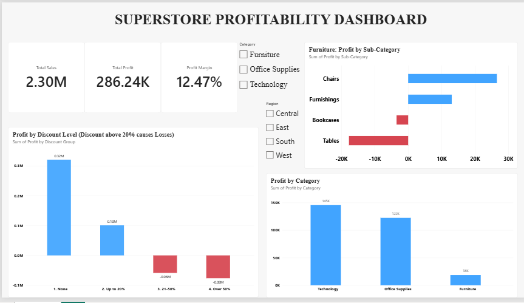

# Superstore Profitability Analysis

Analysis of the Superstore sales dataset (9,994 orders) to find what drives profit and loss, using **Python** and **Power BI**.

## Dashboard

## Business Questions
1. Which categories and products make or lose money?
2. Do discounts reduce profit?
3. How much does each extra discount point cost in profit?

## Tools
- **Python** (pandas, matplotlib, scipy, statsmodels) for cleaning, statistical tests and modeling
- **Power BI** for the interactive dashboard (DAX measures, slicers)

## Key Findings
- **Furniture earns only a ~2.5% profit margin**, compared with ~17% for Technology and Office Supplies.
- **Tables lose about $17.7K overall**, and Bookcases also lose money.
- **Heavy discounts cause losses:** orders discounted above 20% lost about $135K in total, while orders at 20% or below earned about $421K.
- **Welch's t-test:** heavily discounted orders (>20%) have significantly lower profit (average -$97 vs +$49, p < 0.001).
- **Multiple regression (R² = 0.27):** each extra 10 percentage points of discount reduces order profit by about $23, controlling for sales and quantity.

## Recommendation
Cap discounts at around 20% and review pricing and discount policy for Tables and Bookcases.

## Process
1. Cleaned the data in Python: removed 17 duplicate rows and checked data types and missing values.
2. Explored profit by category, sub-category and discount level.
3. Ran a Welch's t-test and a multiple linear regression.
4. Built a Power BI dashboard with KPI cards (Total Sales, Total Profit, Profit Margin), charts and slicers for Region and Category.

## Files
- `Superstore_Analysis.ipynb`: Python analysis (cleaning, t-test, regression)
- `superstore_cleaned.csv`: cleaned dataset
- `superstore_dashboard.pbix`: Power BI dashboard (open with Power BI Desktop)
- `dashboard.png`: dashboard screenshot

## Data
Superstore sample sales dataset (public, from Kaggle). The notebook reads the original `SampleSuperstore.csv` from `archive.zip`.

## Limitations
- The dataset has no date column, so no time-based trend or forecasting was possible.
- The regression explains about 27% of the variation in profit, and the data has large outliers, so the coefficients are indicative rather than exact.
- This is a sample dataset used for learning.
